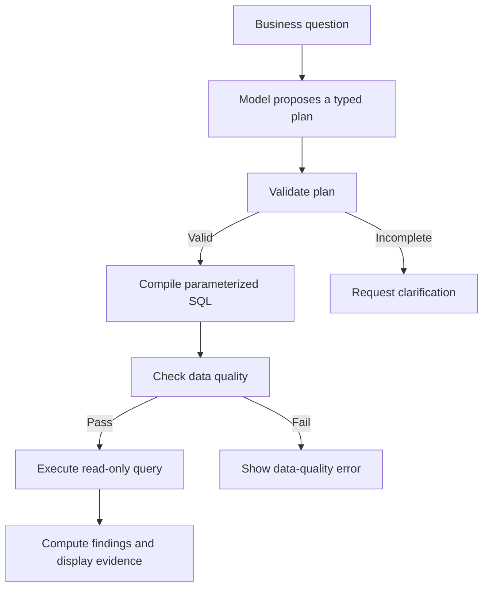

# Pine Labs Case 2 · Enterprise AI Business Analyst

## 1. Build target

Build a local analyst for payment operations. The primary demo question is **“Why did payment success rate fall from October 5–11 to October 12–18, 2026? Break it down by bank.”** The app should answer from synthetic data, show the executed SQL and its bound parameters, reconcile the decline into bank mix and within-bank performance, and state what an analyst should investigate next.

The Pine Labs brief allows 48 hours and asks for a public GitHub repository and a short demo video. This plan budgets **24 elapsed hours**. As of 21 November 2026, GitHub reports [vidit2004/PineLabs_Task](https://github.com/vidit2004/PineLabs_Task) as empty. The file layout below is a starting proposal. Implementation and debugging run in VS Code. A pushed branch and commit SHA identify what to review here at each checkpoint.

| Brief requirement | Acceptance evidence |
|---|---|
| At least two related datasets | Transaction attempts join to a bank dimension with unique bank IDs. The README documents both grains. |
| Natural-language metrics and trends | The analyst accepts the main question, evaluates a paraphrase and asks for clarification if the comparison dates are absent. |
| Generate and execute structured analysis | A model proposes a typed plan. Valid plans compile to parameterized SQL, which executes against the local database. |
| Show query, charts or tables and evidence | The result includes a success-rate chart, bank evidence table, executed SQL, parameters, dataset labels, metric definition and windows. |
| Distinguish facts, hypotheses and recommendations | The answer labels each explicitly and treats mix and performance effects as descriptive attribution. |
| Demonstrate one failure | A second fixture has a missing terminal status. The quality gate blocks the answer and explains the repair. |

## 2. Architecture and libraries

Use **Python 3.11 or 3.12**, Streamlit for the UI, Python's built-in SQLite and CSV support for local data and SQL, Pydantic for plan validation, pandas for display tables, Altair for charts, and pytest for verification. Use one model provider adapter, selected according to the API credentials already available on the development machine. Pin package versions verified in a clean environment and include the exact Python version used in the README.



**Model boundary.** Pass the question and a compact catalog of approved metrics and dimensions to the model. Keep uploaded or generated rows, credentials and execution tools outside the model context. Let Python compute every displayed number and render the facts from result objects. Keep a clearly labeled **offline demo** with preset validated plans for the shipped examples. Keep the same validation and execution path in both modes. When the live model times out, returns invalid output or requests an unsupported analysis, show the state and let the user choose a supported preset or refine the question. Live planning needs a separate smoke test so the video and README can accurately state which mode ran.

**Execution boundary.** Read the database through a read-only connection. Use one application-owned SELECT template for each supported intent with a fixed join and grouping. Bind dates and approved filter values as parameters. Apply a date-range cap, such as 31 days per window. Limit output through fixed grouping dimensions, and add a bounded SQLite execution deadline if the core path is already stable. Show user-readable errors for unknown dimensions and invalid date ranges before execution. Avoid a public raw-SQL input.

### Plan contract

| Field | Contract |
|---|---|
| `intent` | `compare` or `trend`. Comparison accepts a baseline and current window. Trend accepts one window and yields daily rates. |
| `metric` | `success_rate`. Publish successful attempts and eligible attempts as supporting counts. |
| `group_by` | `bank` or `overall`. Use bank for the main comparison and overall for the daily trend. Ask the user to reformulate unsupported combinations. |
| `baseline`, `current` | Structured start and exclusive end dates. Dates in questions read as inclusive through the stated final day. Compare equal-length, ordered, non-overlapping windows. Show the resolved date boundaries. |
| `bank_ids` | Optional list of known bank IDs. If filters remove all data or only one cohort remains, handle the result explicitly. |
| Clarification outcome | A separate typed response carrying a short follow-up question, such as “Which two date ranges should I compare?” |

Reject unexpected fields and type violations. In version one, accept explicit dates and named shipped sample weeks. For relative wording such as “last week,” ask for dates unless the app declares a reference date and resolves it visibly. Require both comparison windows to contain eligible attempts. Represent an empty day in trend mode as missing data rather than a 0% success rate.

## 3. Data, query and interpretation

| Dataset | Grain and columns |
|---|---|
| `transactions.csv` | One payment attempt per `attempt_id`. Fields are `attempt_id`, `event_date_ist`, `bank_id` and `status`. Valid statuses are `SUCCESS` and `FAILED`. Each retry, if modeled, has its own attempt ID. |
| `banks.csv` | One row per `bank_id`, with `bank_name`. Use fictional Bank A and Bank B. |

Seed a 14-day fixture deterministically. Spread each bank's counts across all seven days within each week so trend questions have data. Store source CSVs or a reproducible generator in the repository and expose the dataset variant in the UI. Use a staging import that checks duplicate attempt IDs, duplicate bank IDs, unmatched bank IDs and missing or invalid statuses before the metric query. Scope transaction checks to the comparison windows and selected banks where possible. If a selected row has an invalid status, show the affected window and count, and suppress the affected result. Use a separate broken fixture with a single missing status in the current week. Keep the clean fixture stable across runs.

**Metric definition.** Success rate is successful attempts divided by eligible terminal attempts. In the synthetic fixture, eligible means a row with `SUCCESS` or `FAILED` and a valid bank key. Build counts at the bank-and-window grain and compute the overall metric by summing counts first. Label attempt share by bank as bank mix. Use IST calendar dates and half-open bounds. The windows are `[2026-10-05, 2026-10-12)` and `[2026-10-12, 2026-10-19)`.

| Bank | Baseline successes / attempts | Baseline rate | Current successes / attempts | Current rate |
|---|---:|---:|---:|---:|
| Bank A | 784 / 800 | 98.0% | 392 / 400 | 98.0% |
| Bank B | 180 / 200 | 90.0% | 528 / 600 | 88.0% |
| Overall | 964 / 1,000 | 96.4% | 920 / 1,000 | 92.0% |

**SQL inputs and outputs.** The comparison compiler takes four named date parameters plus any validated bank filters. The template joins `transactions.bank_id` to `banks.bank_id`, filters to the requested windows and eligible statuses, labels each row `baseline` or `current`, then groups by period and bank. Return `period`, `bank_id`, `bank_name`, `attempts` and `successes` in stable order. Trend mode groups by IST date. Display the exact executed metric query and bound parameters in an evidence expander. Keep the quality-check result visible on the answer or failure screen.

**Decomposition.** For bank $i$, let $w_{0i},w_{1i}$ be its baseline and current shares of attempts and $r_{0i},r_{1i}$ its corresponding success rates. Attribute the change to mix using baseline rates, $\sum_i(w_{1i}-w_{0i})r_{0i}$, plus within-bank performance using current shares, $\sum_i w_{1i}(r_{1i}-r_{0i})$. This convention assigns the interaction to within-bank performance. The example reconciles exactly before rounding.

- **Observed.** Success rate fell **4.4 percentage points**, from **96.4% to 92.0%**. Bank B's attempt share rose from **20% to 60%**, and its success rate fell from **90% to 88%**.
- **Descriptive attribution.** The change in bank mix accounts for **−3.2 pp** and within-bank performance accounts for **−1.2 pp** under the stated convention. If a bank is absent in one window, still show supported overall rates and counts, and report that the decomposition requires each bank to have observations in both windows.
- **Hypotheses.** A routing change could explain the share shift. A bank-specific incident could explain the within-bank decline. The fixture has no routing history or response codes to substantiate either hypothesis.
- **Recommended next step.** Ask payment operations to compare routing change logs around October 12 and inspect Bank B's failure codes by day to decide whether to investigate routing, bank availability or both.

## 4. Implementation layout

```text
PineLabs_Task/
  app.py                   # Streamlit screen and presentation
  analyst/
    plan.py                # Typed plan and clarification contracts
    planner.py             # Live model adapter and offline presets
    queries.py             # SQL templates and bound parameters
    data.py                # Staging, quality checks and read-only execution
    analysis.py            # Metrics, mix attribution and evidence objects
  scripts/
    seed_demo.py           # Reproduce clean and broken fixtures
  data/
    fixtures/              # Shipped synthetic inputs
  tests/
    test_plans.py
    test_analysis.py
    test_integration.py
  .env.example
  .gitignore
  requirements.txt
  README.md
```

Use one app screen with the question field, example buttons, mode and fixture controls, and a result area. After a successful run, lead with overall rates and delta, then show a grouped bank rate chart, the counts and shares table, and the evidence panel. When a quality check fails, replace the previous result with the current error and recovery action so a stale success result cannot appear beside the broken dataset. Keep credentials and generated database files out of Git.

## 5. Twenty-four-hour milestones

| Elapsed time | Work | Exit condition |
|---|---|---|
| H0–2 | Set up the Python environment and repository. Generate the two fixtures and document the metric. | Clean seed reproduces the four bank-window rows. |
| H2–6 | Build quality gates, query compiler and analysis functions. | The explicit comparison plan returns 96.4%, 92.0%, −3.2 pp and −1.2 pp. Broken fixture blocks it. |
| H6–10 | Add typed model planning, offline presets and clarification behavior. | Main question and a paraphrase produce equivalent plans. Missing dates produce a clarification without a metric query. |
| H10–14 | Connect Streamlit, chart, evidence and failure screen. | One screen supports clean compare, daily trend and data-quality recovery. |
| H14–18 | Run known-answer and integration checks. Verify setup from a fresh clone. | Tests pass and a fresh clone reproduces the demo using README steps. |
| H18–21 | Draft README and record the video using the tested commit. | Video shows the business answer, SQL, quality failure and recovery. |
| H21–24 | Keep time for defects, a second recording and submission. | Public repo opens in a signed-out session and the video is playable through the submission route. |

If time runs short, keep the happy path, trend example, evidence and quality failure. Defer role-based access, caching and additional datasets. The mix decomposition belongs in the demonstration because it directly answers the business question.

## 6. Verification and failure demo

| Check | Expected behavior |
|---|---|
| Known-answer comparison in both demo windows | Exact fixture counts, weighted rates and reconciled components above. |
| Text-to-plan | Main question and paraphrase match the target plan. Missing dates request clarification. Unsupported metrics and fields stop before metric SQL. |
| Query execution | Bank filters use bound values. A row on October 12 counts in the current window only. A row on October 19 falls outside both windows. |
| Trend and empty data | Trend yields daily rates. Empty dates or absent cohorts are visible. Zero denominator produces an unavailable rate. |
| Bad source data | A missing status, duplicate ID or invalid bank key triggers the expected quality error. The broken fixture cannot reuse a previous result. |
| Model failure | A stubbed timeout or invalid response shows a planner error and permits explicit offline demo selection. |
| End-to-end smoke test | Run the same question against clean, broken and clean fixtures. Confirm SQL and evidence appear for each clean run. |

For the recorded failure, select **Broken fixture** and rerun the exact same question. Show this message or equivalent wording: **“Analysis blocked. One payment attempt in October 12–18 has a missing status. Correct the source record or choose a clean dataset and rerun.”** Show the failed check and prove the prior comparison has cleared. Restore **Clean fixture** and rerun to recover the answer.

## 7. Demo video script

| Time | Screen and narration |
|---|---|
| 0:00–0:25 | “Payment operations sees a drop in success rate. I’ll use the analyst to find what drove it and show the query behind the answer.” Identify synthetic data and the planner mode in use. |
| 0:25–1:00 | Submit the main question. Show the plan, chart and rates. “Success fell from 96.4% to 92.0%, a 4.4 percentage-point drop.” |
| 1:00–1:45 | Open the bank table and SQL evidence. “Bank B handled 60% of attempts, up from 20%. The mix shift accounts for 3.2 points of the decline. Within-bank performance accounts for the remaining 1.2 points.” Point to the windows and denominator. |
| 1:45–2:10 | Show the caveat and action. “The breakdown tells us where the decline came from. Routing changes and bank incidents still need to be checked against operations data.” |
| 2:10–2:50 | Switch to the broken fixture. Show the blocked result, then switch back and rerun successfully. |
| 2:50–3:10 | Show README setup and tests. Mention the typed plan, read-only metric execution and the offline demo option. |

The strongest signals for the reviewer are the reconciled mix calculation, visible evidence for each number, and the system's refusal to report a KPI when a relevant source field is missing. In the README, label the fictional input data, the scope of supported questions, the model dependency and the offline mode.

## 8. First VS Code Codex handoff

Paste this into Codex with the repository open.

> Implement the H0–6 vertical slice in the current checkout using this blueprint. Start by reading the repository instructions and inspecting the working tree. Seed the clean and broken synthetic transaction and bank fixtures. Implement the typed analysis plan, the bank-by-window read-only SQL execution path, data-quality gates and the mix decomposition. Add tests that assert the four bank-window counts, the 96.4% and 92.0% rates, the −3.2 pp and −1.2 pp effects, and that a missing status blocks the answer. Keep model and UI work for the next milestone. Run the tests, report the commands and results, and list changed files and known gaps.

At each push, record the branch, commit SHA, test command and outcome. Use that revision to review the implementation against the acceptance table, then turn the next gap into a scoped VS Code task.
